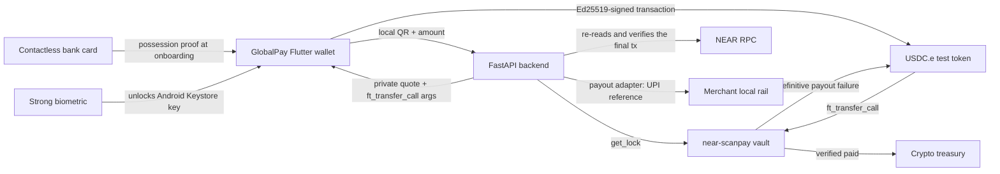
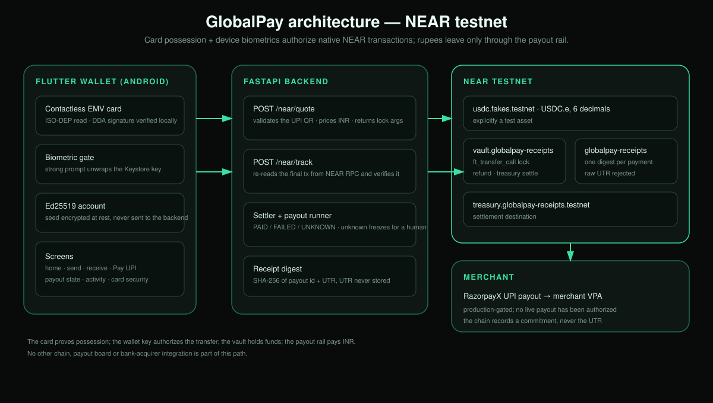
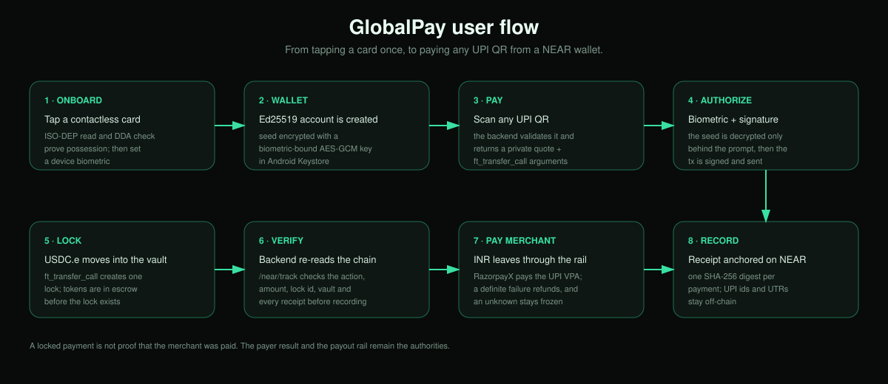

# GlobalPay — stablecoins in, local money out, settled on NEAR

GlobalPay lets someone holding a stablecoin pay a merchant who only accepts a local instant‑payment
rail. The merchant is paid in ordinary local currency; the payer needs no bank account in that
country, no gas, and no seed phrase on paper. The escrow, payout state machine and receipt record run
on **NEAR testnet**.

The first implementation targets **UPI in India** because it is the hardest useful reference: a QR
code on every counter, strict payload rules, and a real merchant payout API. **UPI is the reference
rail, not the boundary of the product.** The chain layer, escrow contract, receipt contract, wallet
and backend are rail‑agnostic. Adding a country means adding a QR parser and a payout adapter — not a
new chain.

> **Honest MVP scope:** the deployed NEAR contract safely locks, refunds and settles `USDC.e` test
> tokens to a crypto treasury. RazorpayX `PAID / FAILED / UNKNOWN` orchestration is implemented, but
> **no live INR payout was authorized or sent**. `Locked` never means a merchant received money.

---

## Why UPI first, and what is actually global

| Layer | Global design | India reference implementation |
|---|---|---|
| Settlement asset | Any NEP‑141 stablecoin | `usdc.fakes.testnet` (`USDC.e`, 6 decimals, test asset) |
| Escrow | `near-scanpay`: lock, refund, settle | Deployed on NEAR testnet |
| Receipts | `near-receipts`: one digest per payment | Deployed on NEAR testnet |
| Payer wallet | Self‑custodial Ed25519 wallet, biometrics | Flutter app on Android |
| Local rail | Adapter: parse a QR, pay the merchant | **UPI**: VPA/QR parsing + RazorpayX payout |
| Merchant receives | Local fiat through the rail | **INR** to a UPI ID |

**Adding another rail** (Pix in Brazil, SEPA Instant in the EU, FedNow/ACH in the US, etc.) means:

1. a parser for that rail's QR/payload format, next to `services/api-py/app/qr.py`;
2. a payout adapter that returns `paid` / `failed` / `unknown`, next to `app/razorpayx.py`;
3. a currency label in the quote, next to the INR pricing.

The vault, receipt contract, wallet key handling, payout state machine and receipt digest do not
change. That separation is the point of the project.

---

## How a payment works

1. **Onboard once.** The payer taps a contactless bank card. The app reads it over ISO‑DEP and verifies
   the card's dynamic signature locally, which proves the physical card is present. The card is a
   possession factor for onboarding — it is never charged and its payment key is never extracted.
2. **Create the wallet.** The app generates an Ed25519 seed locally. Android Keystore wraps it with a
   biometric‑bound AES‑GCM key. Only ciphertext, the public key and the NEAR account id are stored.
3. **Scan the merchant's QR.** In the reference rail this is a UPI QR. The backend validates the
   payload and rejects things it cannot safely pay (for example BharatQR).
4. **Get a private quote.** The backend prices the local amount in the stablecoin and returns a private
   quote plus the native `ft_transfer_call` arguments. The quote is short‑lived.
5. **Approve with biometrics.** The app shows the exact amount and recipient. A fresh strong‑biometric
   prompt unwraps the seed, the app signs a native NEAR transaction, and the seed is wiped from memory.
6. **Lock the funds.** The token's `ft_transfer_call` invokes `near-scanpay.ft_on_transfer`. The tokens
   are inside the contract **before** the lock exists, and the lock is unique per payment.
7. **Verify independently.** The backend re‑reads the final transaction from NEAR RPC through
   `POST /near/track` and checks the action, amount, lock id, vault and every receipt before recording
   it. It never trusts the app's claim alone.
8. **Pay the merchant.** The payout adapter sends local money over the merchant's rail. A **definite
   failure** returns the lock to `RefundPending → Refunded`. An **unknown** outcome stays frozen for a
   human — refunding an ambiguous payout could pay the merchant and return the escrow.
9. **Anchor a receipt.** A SHA‑256 digest of the payout id and reference is stored on NEAR. Raw UPI
   details, payee names and UTRs stay off‑chain.







---

## Escrow and payout lifecycle

[`near-scanpay/`](near-scanpay/) exports:

- `ft_on_transfer` — creates a unique lock after the tokens arrive;
- `get_lock` and `total_locked` — read‑only views;
- `request_refund` — payer cancels before a payout starts;
- `start_payout` — removes the payer's refund authority before provider hand‑off;
- `request_settlement` — sends verified‑paid escrow to the treasury;
- private callbacks that finalize only successful NEP‑141 receipts.

```text
Locked
  ├─ cancel before payout ─────────────► RefundPending ─► Refunded
  └─ start payout ─► PayoutPending
       ├─ definite failure ────────────► RefundPending ─► Refunded
       ├─ unknown outcome ─────────────► stays PayoutPending (human review, never auto‑refund)
       └─ verified paid ───────────────► SettlementPending ─► Settled to treasury
```

The contract cannot itself prove a bank credit. The backend advances only after the payout provider
reports `processed` with both a payout id and a bank reference. Settlement stores a single SHA‑256
commitment to those two values, never the values themselves.

### Wallet security

- The Ed25519 seed is generated on the phone and never sent to the backend.
- A biometric‑bound AES‑GCM key in Android Keystore wraps it; every signature needs a fresh prompt.
- The transaction serializer is pinned byte‑for‑byte against `near-api-js 7.1.0` in Flutter tests.
- The EMV card proves possession for onboarding and custom NFC flows. It does not authorize ordinary
  QR payments — those need the biometric‑protected wallet key.
- GlobalPay never derives the wallet from card data, debits the bank card, reads the owner's identity,
  or extracts the card's payment private key.

---

## Verified NEAR deployment

| Item | Value |
|---|---|
| Network | `testnet` |
| RPC | `https://rpc.testnet.near.org` |
| Token | `usdc.fakes.testnet` — `USDC.e`, 6 decimals, **test asset** |
| Demo account | `demo.globalpay-receipts.testnet` |
| Vault | `vault.globalpay-receipts.testnet` |
| Crypto treasury | `treasury.globalpay-receipts.testnet` |
| Vault code hash | `5nYE82Dc8raan8YFcbFoSN8qfwjor6thatviDFJps8zZ` |
| Receipt contract | `globalpay-receipts.testnet` |

`usdc.fakes.testnet` is not production Circle USDC. Metadata, account ids, code hashes and complete
transaction evidence are in [`deployments/near-testnet.json`](deployments/near-testnet.json).

### Real testnet transactions

| Check | Transaction |
|---|---|
| Deploy safe MVP vault | [`HrE6…Xyy1`](https://explorer.testnet.near.org/transactions/HrE6Ai9zL4HpEJC1kVKpzXMyLE6jidKgKAn4FobnXyy1) |
| Lock 1 USDC.e with `ft_transfer_call` | [`73W2…2S7a`](https://explorer.testnet.near.org/transactions/73W2bhLAyD28getf1XWVUcmBZ6632uriwnVjXuF12S7a) |
| Successful callback refund | [`2WHh…tK4n`](https://explorer.testnet.near.org/transactions/2WHh1PxWyFouUeqhw1tTkLZJRLVit5nsUzNmWqPatK4n) |
| Deliberately failed token transfer | [`574Q…p2KfV`](https://explorer.testnet.near.org/transactions/574Q444RCD1oNeYVmDzHV7rN3WCqqeLkV2Kv6YGp2KfV) |
| Successful retry after re‑registration | [`6UnQ…sTfvC`](https://explorer.testnet.near.org/transactions/6UnQ8ssJGkw8v2661Tvp4dfoBXZMrCpkzd4BaVEsTfvC) |
| Flutter‑wallet signed lock | [`D7UL…FqRp`](https://explorer.testnet.near.org/transactions/D7ULnQkgMtCrNi3Br3mda2fnwyR5PZNhkt4gyJGZFqRp) |
| Flutter‑wallet signed refund | [`BRAk…yPAW`](https://explorer.testnet.near.org/transactions/BRAkBMCQ1uA3ri7cb77KnPsbZEYR4W288vigqVYXyPAW) |
| Treasury upgrade / migration | [`A7MR…kVmp`](https://explorer.testnet.near.org/transactions/A7MRst1Es4Whit141hg2ZbqGSBec9uy5Zw75BrU5kVmp) / [`H1tj…zUyE`](https://explorer.testnet.near.org/transactions/H1tjXKJNyFWuagM2aZDrskKhUrhNk71VRERmheErzUyE) |
| Synthetic **no‑INR** treasury settlement | [`29he…qsys`](https://explorer.testnet.near.org/transactions/29hecU8F96d476ZuRrcNdZCGVZ7BQZGHHaSZJonjqsys) |

The failed refund matters: the callback returned the lock to `Locked`, accounting stayed intact, and a
later retry returned every token. The synthetic settlement moved 0.001 test USDC.e from the vault to
the treasury and proves only that crypto leg — not a merchant bank credit.

---

## Repository layout

| Path | What it is |
|---|---|
| [`apps/mobile-flutter/`](apps/mobile-flutter/) | Android wallet: NEAR account, Send, Receive, Pay UPI, payout state, card security |
| [`services/api-py/`](services/api-py/) | FastAPI backend: `/near/*`, quote, track, settle, payout adapters, receipts |
| [`near-scanpay/`](near-scanpay/) | NEAR escrow contract and its 25 tests |
| [`near-receipts/`](near-receipts/) | NEAR receipt anchor and its 14 tests |
| [`deployments/near-testnet.json`](deployments/near-testnet.json) | Deployed account ids, hashes and transaction evidence |
| [`docs/hackathon/`](docs/hackathon/) | Feature status, architecture, demo script and screenshot story |
| [`docs/adr/`](docs/adr/) | Network/token, payment/auth and storage/callback decisions |
| `contracts/`, `apps/web/` | **Legacy EVM modules kept for reference.** They are not part of the NEAR payment path. |

---

## Build and test

### NEAR contracts

```sh
cd near-scanpay && cargo test && cargo build --target wasm32-unknown-unknown --release
cd ../near-receipts && cargo test && cargo build --target wasm32-unknown-unknown --release
```

### Backend

```sh
cd services/api-py
uv run pytest -m "not live"
CHAINS=near WORKERS=0 FX=1 uv run uvicorn app.main:app --host 127.0.0.1 --port 8788
```

`CHAINS=near` deliberately enables no legacy EVM chain; the NEAR routes are separate.

| Route | Purpose |
|---|---|
| `GET /near/config` | network, token, vault, treasury and payout capabilities |
| `GET /near/account/{accountId}` | NEAR balance, token balance and storage registration |
| `POST /near/quote` | validate the local QR, price it, return lock arguments |
| `POST /near/track` | re‑read and verify the final transaction before recording it |
| `GET /near/payment/{id}` | one payment's state |
| `GET /near/history/{accountId}` | that account's payments |

### Flutter hackathon build

```sh
cd apps/mobile-flutter
flutter test
flutter build apk --debug \
  --dart-define=NEAR_MVP=true \
  --dart-define=NEAR_ACCOUNT_ID=demo.globalpay-receipts.testnet \
  --dart-define=GLOBALPAY_URL=http://127.0.0.1:8788
```

`NEAR_MVP=true` opens the NEAR wallet. Without it, the app builds the preserved card/EVM wallet.
Phone provisioning and demo steps are in [`docs/hackathon/DEMO.md`](docs/hackathon/DEMO.md).

---

## Verification

| Suite | Last result |
|---|---:|
| NEAR vault (`near-scanpay`) | **25 passed** |
| NEAR receipts (`near-receipts`) | **14 passed** |
| Python backend, offline | **230 passed**, 16 live deselected |
| Flutter | **18 passed**, analyzer 0 errors / 0 warnings |
| Web unit tests | **92 passed** |

Legacy EVM suites (Foundry, Hardhat) and the agent/UPI‑payer suites exist but are not part of the NEAR
payment path and were not re‑run at this checkpoint.

---

## Known limitations

- **No live merchant payout has been sent.** RazorpayX orchestration is implemented and tested with
  mocks; production requires `APP_ENV=prod`, `PAYOUT_RAIL=razorpayx`, `NEAR_PAYOUTS=1` and a funded
  settler account. Until then, the proven path ends at the crypto treasury.
- **`near-receipts` is a receipt anchor**, not a full public payout board.
- **The available POCO has no NFC.** The biometric/Keystore and app‑signed lock/refund are proven on
  that phone; a physical card tap needs an NFC‑capable device.
- **UPI is the only implemented local rail.** Other corridors need their own QR parser and payout
  adapter, as described above.
- **Testnet only.** This is hackathon software, not audited production infrastructure.
- **Legacy modules remain in the tree** for reference and are not presented as NEAR code.

---

## Documentation

- [Feature status](docs/hackathon/FEATURE_STATUS.md)
- [Architecture notes](docs/hackathon/ARCHITECTURE.md)
- [Demo script](docs/hackathon/DEMO.md)
- [Phone screenshot story](docs/hackathon/DEMO_STORY.md)
- [Submission draft](docs/hackathon/SUBMISSION.md)
- [Network and token ADR](docs/adr/001-near-network-and-token.md)
- [Payment and authentication ADR](docs/adr/002-near-payment-intent-and-authentication.md)
- [Storage and callback ADR](docs/adr/003-near-storage-and-refund-callbacks.md)

## Team

Built by [@vi5hnuraj](https://github.com/vi5hnuraj) and [@aagneye](https://github.com/aagneye).

## License

MIT — see [`LICENSE`](LICENSE).
