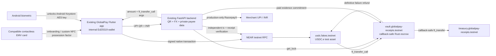

# GlobalPay NEAR MVP architecture

## Trust model

- NEAR authenticates the internal Ed25519 account key.
- Android Keystore and biometrics protect that key locally.
- The EMV card is a local possession factor for onboarding/card-reader flows. UPI and direct NEAR
  transfers use biometric approval; the vault does not verify a biometric or card.
- The backend cannot spend from the internal wallet and receives no private key.
- The backend verifies finalized chain data before recording a lock.
- Before provider hand-off the vault removes payer refund authority. Only verified paid evidence can
  move escrow to treasury; unknown payout outcome stays frozen and definitive failure may refund.
- RazorpayX, not the vault, reports bank payout state. A `Settled` crypto transfer is not independently
  generated bank-credit proof.

## Preserved systems

The EVM vaults, card smart-wallet contracts, Circle agent wallets, Pi terminal, Razorpay rails and
existing web payment path remain in the repository unchanged. They are the prior product baseline,
not disguised as NEAR functionality.
